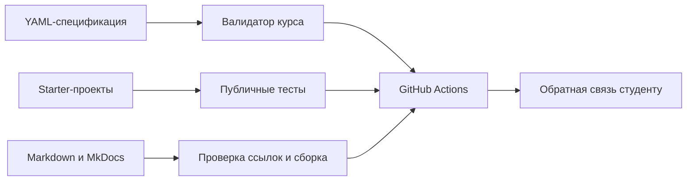

# Разработка прикладных программных решений для систем искусственного интеллекта

[](https://github.com/Gorod89/fos-repository-softeng/actions/workflows/course-quality.yml)
[](https://gorod89.github.io/fos-repository-softeng/)

Открытая русскоязычная образовательная платформа дисциплины: рабочая программа,
КИМ, воспроизводимые starter-проекты, машиночитаемые рубрики, автоматические
проверки и материалы для GitHub Classroom.

Курс учит не отдельным командам, а полному инженерному циклу: архитектура,
данные, Git, качество Python-кода, анализ данных, REST API, контейнеризация и
CI/CD.

## Быстрый старт

Самый простой путь — открыть репозиторий в GitHub Codespaces. Для локальной
работы нужны Git, Python 3.12, uv и Docker:

```bash
git clone https://github.com/Gorod89/fos-repository-softeng.git
cd fos-repository-softeng
uv sync --frozen
make validate
make test
make docs
```

Полная инструкция: [быстрый старт](docs/student-guide/getting-started.md).

## Результаты обучения

После курса студент умеет:

1. проектировать архитектуру ИИ-приложения и обосновывать компромиссы;
2. создавать и оптимизировать воспроизводимые ETL-пайплайны для PostgreSQL;
3. применять продвинутый Git и командный процесс через pull request;
4. разрабатывать тестируемый, типизированный Python-код;
5. выполнять воспроизводимый анализ данных и реализовывать векторизованные алгоритмы;
6. создавать, контейнеризировать и проверять REST API с базовым CI/CD.

Каноническая трассировка хранится в
[`course-spec/learning-outcomes.yml`](course-spec/learning-outcomes.yml).

## Траектория курса

| Модуль | Тема | Исполняемое задание |
|---:|---|---|
| 1 | Архитектура ИИ-приложений | [`M1-architecture-starter`](assignments/M1-architecture-starter/README.md) |
| 2 | PostgreSQL и ETL | [`M2-databases-starter`](assignments/M2-databases-starter/README.md) |
| 3 | Продвинутый Git | [`M3-advanced-git-starter`](assignments/M3-advanced-git-starter/README.md) |
| 4 | Инженерные инструменты Python | [`M4-python-tooling-starter`](assignments/M4-python-tooling-starter/README.md) |
| 5 | NumPy и KNN | [`M5-numpy-knn-starter`](assignments/M5-numpy-knn-starter/README.md) |
| 6 | Pandas и EDA | [`M6-pandas-eda-starter`](assignments/M6-pandas-eda-starter/README.md) |
| 7 | REST API на FastAPI | [`M7-fastapi-starter`](assignments/M7-fastapi-starter/README.md) |
| 8 | Docker и CI/CD | [`M8-docker-starter`](assignments/M8-docker-starter/README.md) |

Исходные КИМ и расширенные методические материалы сохранены в каталогах
[`M1-architecture`](M1-architecture/README.md) —
[`M8-docker`](M8-docker/README.md).

## Оценивание

Модель однозначно дает 100 баллов:

| Компонент | Баллы |
|---|---:|
| 8 лабораторных работ × 6 | 48 |
| 4 лучших устных сообщения × 2 | 8 |
| Групповая Git-игра | 4 |
| Курсовая работа | 40 |
| **Итого** | **100** |

Форма промежуточной аттестации — **зачет**. Результат «зачтено» выставляется при
60 баллах и выполнении обязательных условий. Теоретические вопросы и практическая
задача на защите подтверждают авторство и не добавляют баллов сверх 100.

Единый источник истины:
[`course-spec/assessment-model.yml`](course-spec/assessment-model.yml).

## Как работает автопроверка



Публичные тесты проверяют интерфейс и базовые случаи. Закрытые тесты хранятся
отдельно и подключаются преподавателем через GitHub Classroom. Автоматическая
часть составляет 40–60% лабораторной; инженерные решения и авторство
подтверждаются ревью и защитой с изменением условий.

## Навигация

### Студенту

- [задания и траектория](docs/student-guide/assignments.md);
- [правила оценивания](docs/student-guide/assessment.md);
- [ответственное использование ИИ](AI_USAGE_POLICY.md);
- [курсовая работа](Project/README.md);
- [зачет](Exam/README.md).

### Преподавателю

- [запуск курса](docs/instructor-guide/getting-started.md);
- [GitHub Classroom](docs/instructor-guide/classroom.md);
- [проверка и защита](docs/instructor-guide/grading.md);
- [аналитика качества](docs/instructor-guide/analytics.md);
- [семестровые релизы](docs/instructor-guide/releases.md).

### Управление продуктом

- [рабочая программа](docs/rpd.md);
- [модель качества](docs/quality-model.md);
- [история изменений](CHANGELOG.md);
- [правила участия](CONTRIBUTING.md);
- [безопасность](SECURITY.md);
- [архитектурные решения](docs/adr/0001-course-spec.md).

## Воспроизводимость и безопасность

- Python и зависимости фиксируются `.python-version` и `uv.lock`;
- каждый starter имеет собственный `pyproject.toml` и `uv.lock`;
- Dev Container включает Python 3.12, Docker CLI, PostgreSQL client и Jupyter;
- данные имеют версию и SHA-256;
- Dependabot, CodeQL и OpenSSF Scorecard контролируют цепочку поставки;
- workflows используют минимальные права;
- `.env`, ключи, закрытые тесты и эталонные решения не публикуются.

## Версии

Семестровые релизы имеют формат `2026-fall-v1.0`. Изменения КИМ, рубрик,
зависимостей, данных и политики ИИ отражаются в [CHANGELOG.md](CHANGELOG.md).

## Команда и лицензия

Сведения об авторах и вкладе: [команда проекта](team/README.md).
Условия зависят от происхождения файла. Новая документация форка предлагается
по CC BY 4.0, новый код — по MIT; исходные материалы требуют согласования с их
авторами. Подробности: [лицензирование и авторские права](LICENSE.md).
